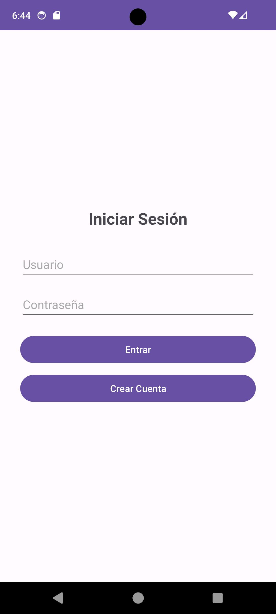
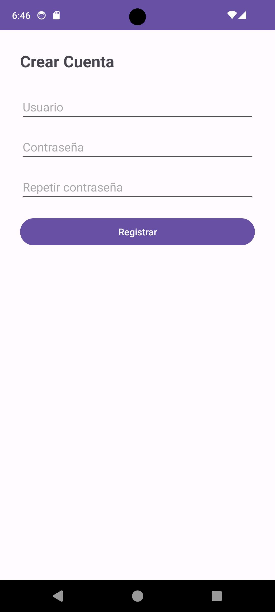
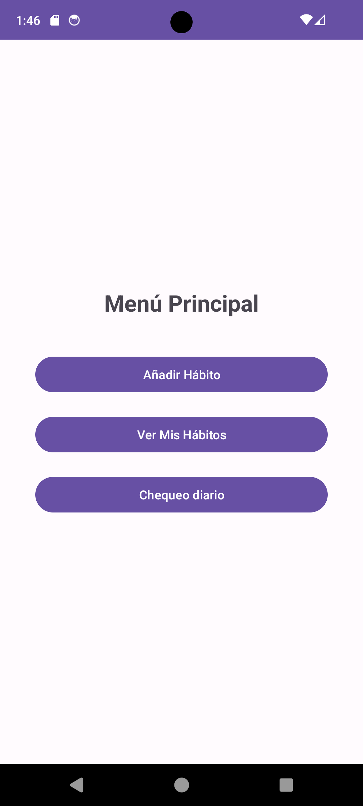
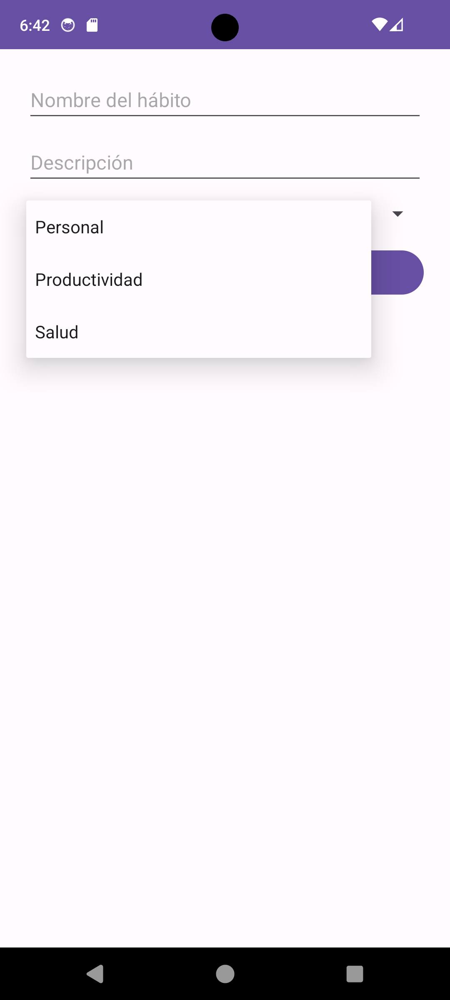
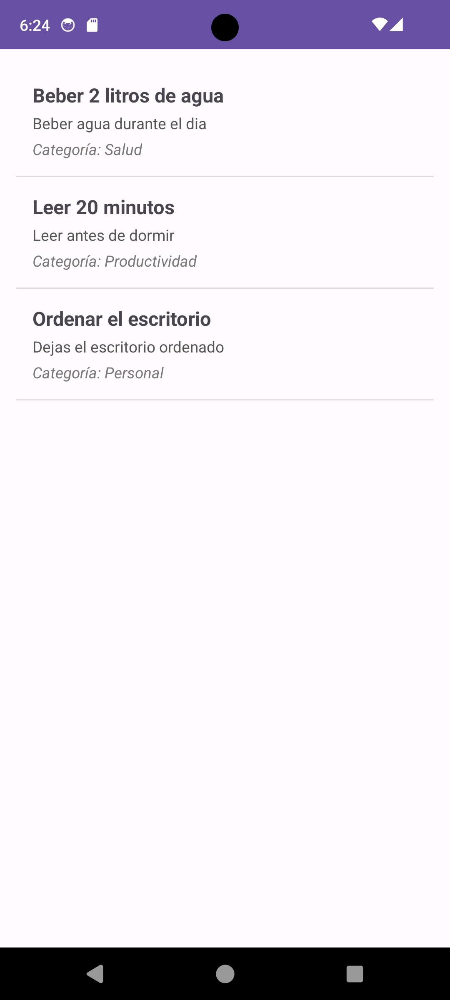
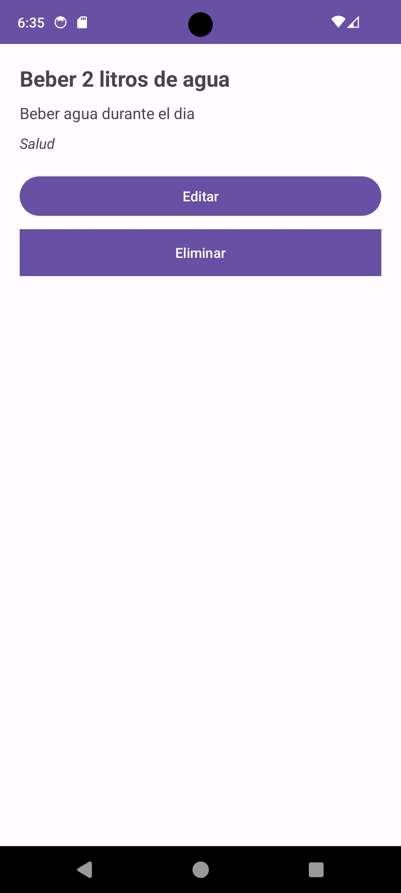
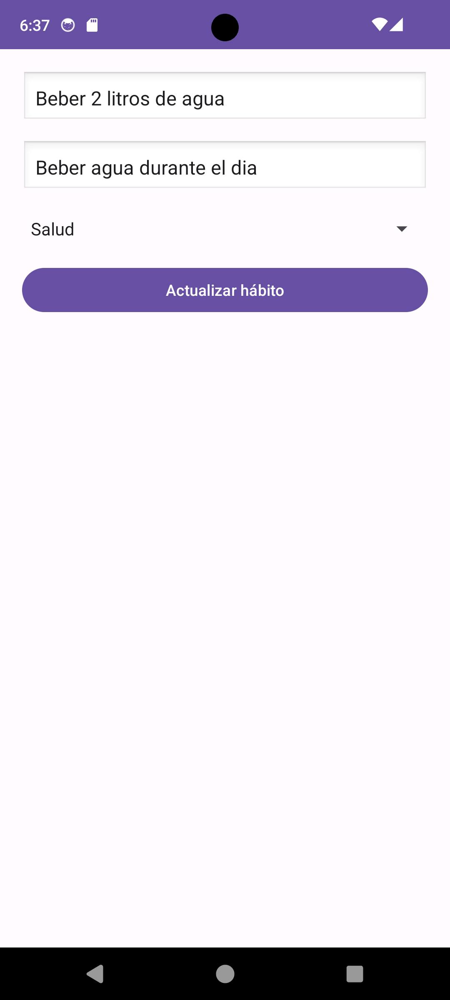
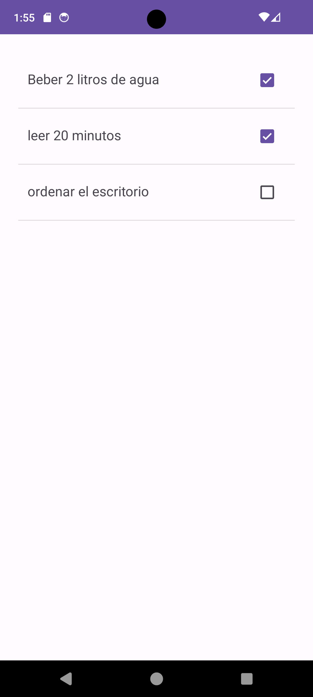

# VitaHabito

Aplicación Android de gestión de hábitos saludables, desarrollada en Kotlin con Android Studio como proyecto del ciclo de Desarrollo de Aplicaciones Multiplataforma (DAM).

Cada usuario crea su cuenta, inicia sesión, gestiona su propia lista de hábitos clasificados por categorías y marca cada día los que ha cumplido. Los datos se guardan en local, en una base de datos SQLite del dispositivo.

**Descarga:** el APK está disponible en la [última release](https://github.com/JotaP86/VitaHabito/releases/latest). Los cambios de cada versión están en el [CHANGELOG](CHANGELOG.md).

## Capturas de pantalla

<table>
  <tr>
    <td align="center"><br>Inicio de sesión</td>
    <td align="center"><br>Registro de usuario</td>
    <td align="center"><br>Menú principal</td>
    <td align="center"><br>Formulario de hábito con selector de categoría</td>
  </tr>
  <tr>
    <td align="center"><br>Lista de hábitos</td>
    <td align="center"><br>Detalle del hábito</td>
    <td align="center"><br>Edición del hábito</td>
    <td align="center"><br>Chequeo diario</td>
  </tr>
</table>

## Funcionalidades

- **Registro de usuario:** nombre de usuario, contraseña y repetición de contraseña. Comprueba que ningún campo esté vacío, que las dos contraseñas coincidan y que el nombre de usuario no exista ya. La contraseña se guarda como hash (ver [Contraseñas](#contraseñas)).
- **Inicio de sesión:** busca el usuario por su nombre y verifica la contraseña contra el hash guardado.
- **Menú principal:** acceso a "Añadir Hábito", "Ver Mis Hábitos" y "Chequeo diario".
- **Crear hábito:** nombre, descripción y categoría, que se elige en un desplegable. El nombre es obligatorio: si está vacío se muestra el aviso "El nombre no puede estar vacío" y no se guarda. La descripción es opcional. El hábito queda asociado al usuario que ha iniciado sesión.
- **Listado de hábitos:** muestra los hábitos del usuario con su nombre, descripción y categoría, y se actualiza al volver a la pantalla.
- **Detalle de hábito:** muestra el nombre, la descripción y la categoría, con las opciones de editar y eliminar.
- **Editar hábito:** permite cambiar el nombre, la descripción y la categoría. El nombre es obligatorio.
- **Eliminar hábito:** borra el hábito junto con sus registros del chequeo diario y vuelve al listado.
- **Chequeo diario:** lista los hábitos del usuario con una casilla para el día actual. Al marcar o desmarcar una casilla se guarda el estado del hábito para la fecha de hoy. Al abrir la pantalla, aparecen marcados los hábitos que ya se marcaron ese día.
- **Categorías por defecto:** al crear la base de datos se insertan Salud, Productividad y Personal.

## Tecnologías

| Elemento | Versión |
|---|---|
| Kotlin | 2.0.21 |
| Gradle (wrapper) | 8.13 |
| Android Gradle Plugin | 8.13.1 |
| compileSdk / targetSdk | 36 |
| minSdk | 24 (Android 7.0) |
| Java (source, target y jvmTarget) | 11 |
| AndroidX AppCompat | 1.6.1 |
| Material Components | 1.9.0 |
| JUnit | 4.13.2 |

- **Interfaz:** layouts XML con `AppCompatActivity`, `ListView` con adaptadores propios (`BaseAdapter`) y `Spinner` para seleccionar la categoría. Tema `Theme.Material3.DayNight.NoActionBar`.
- **Persistencia:** SQLite mediante `SQLiteOpenHelper`, con las claves foráneas activadas.
- **Seguridad:** PBKDF2 de `javax.crypto` para el hash de contraseñas, sin librerías externas.
- **Build:** Gradle con Kotlin DSL (`build.gradle.kts`) y catálogo de versiones (`gradle/libs.versions.toml`).

## Base de datos

La base de datos `vitahabito.db` (versión 6) se gestiona desde `DatabaseHelper` y tiene cuatro tablas:

| Tabla | Contenido |
|---|---|
| `users` | Usuarios registrados. El nombre de usuario es único y la contraseña se guarda como hash. |
| `categories` | Categorías de hábitos. El nombre es único. |
| `habits` | Hábitos, con referencia al usuario (`user_id`) y a la categoría (`category_id`). |
| `habit_logs` | Registros del chequeo diario: estado de cada hábito por fecha, con un máximo de una fila por hábito y día. |

Al eliminar un hábito, sus registros de `habit_logs` se borran antes que el propio hábito, dentro de una única transacción.

El diagrama entidad-relación y el detalle de cada columna están en [docs/database.md](docs/database.md).

## Contraseñas

Las contraseñas se procesan en `PasswordHasher`:

- **Algoritmo:** `PBKDF2WithHmacSHA1`, con una sal aleatoria de 16 bytes generada con `SecureRandom`, 120 000 iteraciones y un resultado de 32 bytes.
- **Formato almacenado** en `users.password`: `pbkdf2_sha1:<iteraciones>:<sal en hexadecimal>:<hash en hexadecimal>`.
- **Verificación:** se recalcula el hash con la sal y las iteraciones guardadas y se compara en tiempo constante. Un valor con formato incorrecto se trata como contraseña no válida.
- **Por qué SHA-1:** con `minSdk` 24, las variantes de PBKDF2 disponibles en Android usan HMAC-SHA1; las basadas en SHA-2, como `PBKDF2WithHmacSHA256`, requieren API 26.

**Actualización desde la versión 1.0.0:** la base de datos pasa de la versión 5 a la 6. Como `onUpgrade` elimina y vuelve a crear todas las tablas, al actualizar se borran las cuentas y los hábitos existentes y hay que registrar un usuario nuevo.

## Tests

`app/src/test/java/com/vitahabitoapp/PasswordHasherTest.kt` contiene 7 tests unitarios de JUnit que se ejecutan en la JVM, sin emulador. Comprueban:

- el formato del valor generado por `hash` (prefijo, iteraciones y longitudes de la sal y del hash);
- que la misma contraseña genera hashes distintos y que ambos se verifican;
- que el valor generado no contiene la contraseña;
- que `verify` acepta la contraseña correcta, también con caracteres como "ñ";
- que `verify` rechaza contraseñas incorrectas y vacías;
- que `verify` rechaza un hash modificado;
- que `verify` devuelve `false` con valores mal formados (partes que faltan, prefijo distinto, iteraciones no válidas o hexadecimal incorrecto).

Para ejecutarlos:

- **Android Studio:** clic derecho sobre `PasswordHasherTest.kt` y **Run 'PasswordHasherTest'**.
- **Línea de comandos** (Linux o macOS):
  ```bash
  ./gradlew testDebugUnitTest
  ```
- **Línea de comandos** (Windows):
  ```bash
  gradlew.bat testDebugUnitTest
  ```

## Estructura del proyecto

```
VitaHabito/
├── app/
│   ├── build.gradle.kts
│   ├── proguard-rules.pro
│   └── src/
│       ├── main/
│       │   ├── AndroidManifest.xml
│       │   ├── java/com/vitahabitoapp/
│       │   │   ├── LoginActivity.kt         Inicio de sesión (pantalla inicial)
│       │   │   ├── RegisterActivity.kt      Registro de usuarios
│       │   │   ├── MenuActivity.kt          Menú principal
│       │   │   ├── HabitFormActivity.kt     Alta de hábitos
│       │   │   ├── HabitListActivity.kt     Listado de hábitos del usuario
│       │   │   ├── HabitDetailActivity.kt   Detalle y borrado de un hábito
│       │   │   ├── HabitEditActivity.kt     Edición de un hábito
│       │   │   ├── DailyCheckActivity.kt    Chequeo diario
│       │   │   ├── HabitAdapter.kt          Adaptador del listado
│       │   │   ├── DailyCheckAdapter.kt     Adaptador del chequeo diario
│       │   │   ├── Habit.kt                 Modelo de hábito
│       │   │   ├── Category.kt              Modelo de categoría
│       │   │   ├── HabitLog.kt              Modelo de registro diario
│       │   │   ├── PasswordHasher.kt        Hash y verificación de contraseñas
│       │   │   └── DatabaseHelper.kt        Acceso a SQLite
│       │   └── res/
│       │       ├── layout/                  Pantallas en XML
│       │       ├── values/                  Colores, textos y tema
│       │       ├── drawable/, mipmap-*/     Iconos de la aplicación
│       │       └── xml/                     Reglas de copia de seguridad
│       └── test/java/com/vitahabitoapp/
│           └── PasswordHasherTest.kt        Tests unitarios
├── docs/
│   ├── database.md                          Modelo de datos
│   └── screenshots/                         Capturas de pantalla
├── gradle/
│   ├── libs.versions.toml
│   └── wrapper/
├── build.gradle.kts
├── settings.gradle.kts
├── gradle.properties
├── gradlew
├── gradlew.bat
├── CHANGELOG.md
└── README.md
```

## Cómo ejecutarla

### Requisitos

- Android Studio compatible con Android Gradle Plugin 8.13
- Android SDK 36
- Emulador o dispositivo con Android 7.0 (API 24) o superior

### Con Android Studio

1. Clona el repositorio:
   ```bash
   git clone https://github.com/JotaP86/VitaHabito.git
   ```
2. En Android Studio, abre la carpeta del proyecto con **File > Open**.
3. Espera a que termine la sincronización de Gradle. Android Studio genera el fichero `local.properties` con la ruta del SDK.
4. Selecciona un emulador o dispositivo y pulsa **Run**.

### Desde la línea de comandos

En Linux o macOS:

```bash
./gradlew assembleDebug
```

En Windows:

```bash
gradlew.bat assembleDebug
```

El APK de depuración se genera en `app/build/outputs/apk/debug/`.

## Uso

1. En la pantalla de inicio, pulsa **Crear Cuenta** y registra un usuario.
2. Inicia sesión con ese usuario.
3. En el menú, pulsa **Añadir Hábito**, escribe el nombre y, opcionalmente, una descripción, elige una categoría y guarda.
4. Pulsa **Ver Mis Hábitos** para consultar la lista. Toca un hábito para ver su detalle y, desde ahí, editarlo o eliminarlo.
5. Pulsa **Chequeo diario** y marca los hábitos que has cumplido hoy.

## Mejoras previstas

- Sustituir el borrado de tablas en `onUpgrade` por migraciones de base de datos que conserven los datos.
- Ejecutar las operaciones de base de datos y el cálculo del hash de contraseñas fuera del hilo principal.
- Eliminar las dependencias y la configuración de Jetpack Compose, que no se usan.
- Añadir tests de interfaz y tests de la capa de base de datos.

## Autor

Juan Pedro Torrecillas García - [GitHub](https://github.com/JotaP86)
