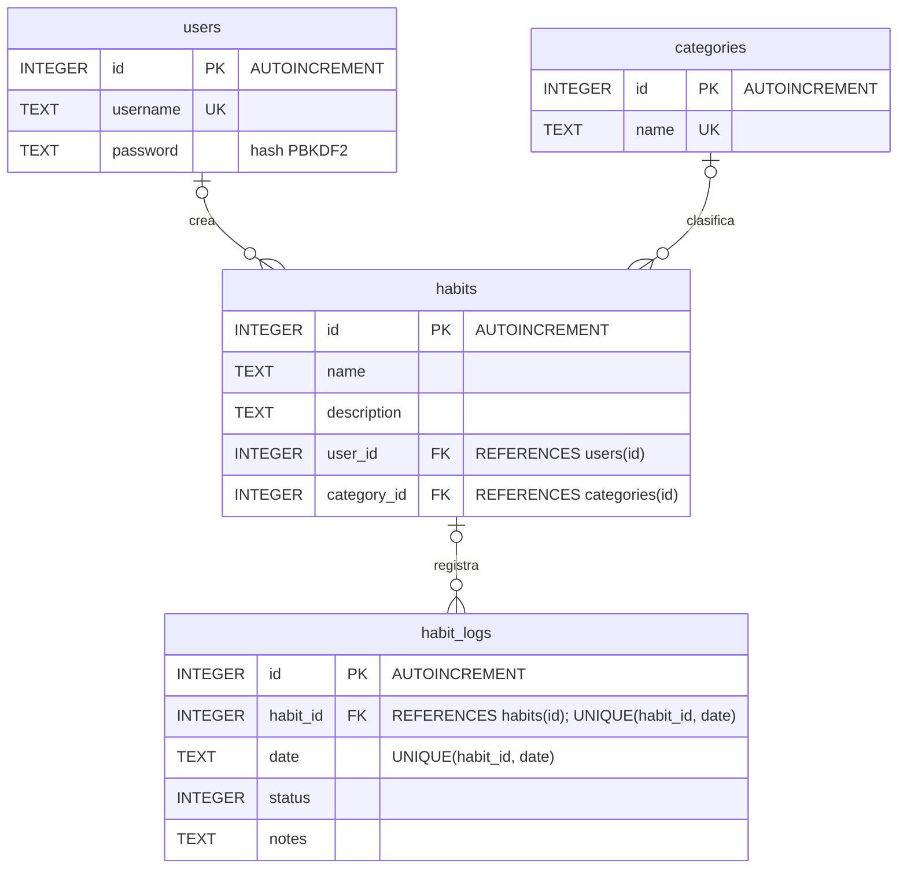

# Modelo de datos

VitaHabito guarda la información en una base de datos SQLite local llamada `vitahabito.db`, gestionada por la clase `DatabaseHelper` (`DB_VERSION = 6`). Las claves foráneas se activan en `onConfigure` con `setForeignKeyConstraintsEnabled(true)`.

## Diagrama entidad-relación



## Tablas

### users

Usuarios registrados en la aplicación.

| Columna | Tipo | Restricciones |
|---|---|---|
| `id` | INTEGER | PRIMARY KEY AUTOINCREMENT |
| `username` | TEXT | UNIQUE |
| `password` | TEXT | |

La columna `password` no guarda la contraseña, sino el valor que genera `PasswordHasher.hash`:

```
pbkdf2_sha1:<iteraciones>:<sal en hexadecimal>:<hash en hexadecimal>
```

Se calcula con `PBKDF2WithHmacSHA1`, una sal aleatoria de 16 bytes, 120 000 iteraciones y un resultado de 32 bytes. `loginUser` busca el usuario solo por `username` y comprueba la contraseña con `PasswordHasher.verify`.

### categories

Categorías con las que se clasifican los hábitos. Al crear la base de datos se insertan Salud, Productividad y Personal.

| Columna | Tipo | Restricciones |
|---|---|---|
| `id` | INTEGER | PRIMARY KEY AUTOINCREMENT |
| `name` | TEXT | UNIQUE |

### habits

Hábitos de cada usuario.

| Columna | Tipo | Restricciones |
|---|---|---|
| `id` | INTEGER | PRIMARY KEY AUTOINCREMENT |
| `name` | TEXT | |
| `description` | TEXT | |
| `user_id` | INTEGER | FOREIGN KEY → `users(id)` |
| `category_id` | INTEGER | FOREIGN KEY → `categories(id)` |

### habit_logs

Registros del chequeo diario. La restricción `UNIQUE(habit_id, date)` permite como máximo una fila por hábito y día; `insertOrUpdateLog` usa `CONFLICT_REPLACE`, de modo que un nuevo registro para la misma fecha sustituye al anterior.

| Columna | Tipo | Restricciones |
|---|---|---|
| `id` | INTEGER | PRIMARY KEY AUTOINCREMENT |
| `habit_id` | INTEGER | FOREIGN KEY → `habits(id)`, UNIQUE junto con `date` |
| `date` | TEXT | UNIQUE junto con `habit_id` |
| `status` | INTEGER | |
| `notes` | TEXT | |

La usa la pantalla de chequeo diario (`DailyCheckActivity`):

- Al marcar o desmarcar un hábito, guarda la fecha del día en formato `yyyy-MM-dd` y `status` con valor `1` (marcado) o `0` (desmarcado). La aplicación no rellena `notes`, que queda con valor nulo.
- Al abrir la pantalla, lee los registros de cada hábito con `getLogsByHabit` y marca los que tienen `status = 1` en la fecha actual.

### Borrado de hábitos

La clave foránea de `habit_logs` hacia `habits` no tiene `ON DELETE CASCADE`. Por eso, `deleteHabit` borra primero los registros del hábito en `habit_logs` y después el hábito en `habits`, dentro de una única transacción (`beginTransaction`, `setTransactionSuccessful` y `endTransaction`). Si una de las dos operaciones falla, no se aplica ninguna.

## Relaciones

- Un usuario puede tener varios hábitos (`habits.user_id`).
- Una categoría puede agrupar varios hábitos (`habits.category_id`).
- Un hábito puede tener varios registros diarios, uno por fecha (`habit_logs.habit_id`).

Ninguna columna está declarada como `NOT NULL`, por lo que las claves foráneas admiten valores nulos; en el diagrama, cada hábito y cada registro aparecen relacionados con cero o un elemento de la tabla referenciada.

## Cambios de versión

Cuando cambia `DB_VERSION`, `onUpgrade` elimina las cuatro tablas y ejecuta de nuevo `onCreate`, por lo que los datos existentes no se conservan. Al pasar de la versión 5 (aplicación 1.0.0) a la versión 6 (aplicación 1.1.0) se borran las cuentas, los hábitos y sus registros.
