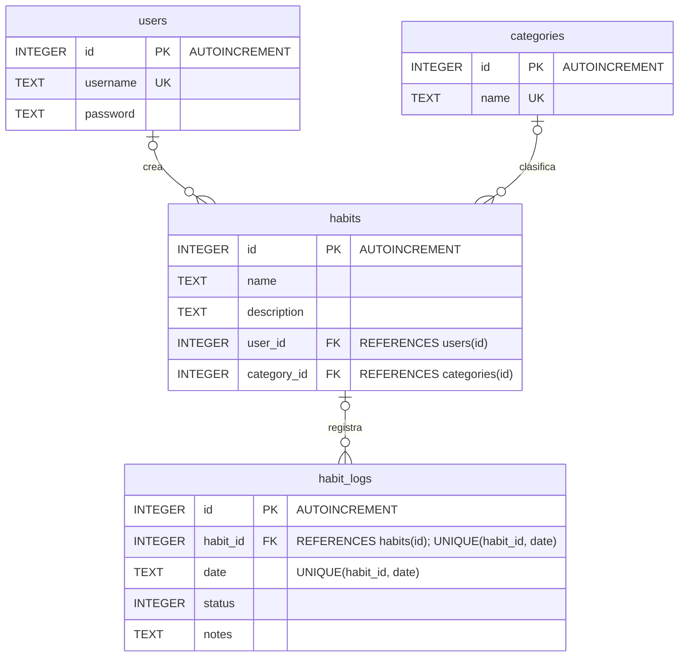

# Modelo de datos

VitaHabito guarda la información en una base de datos SQLite local llamada `vitahabito.db`, gestionada por la clase `DatabaseHelper` (versión de esquema 5). Las claves foráneas se activan en `onConfigure` con `setForeignKeyConstraintsEnabled(true)`.

## Diagrama entidad-relación

## Tablas

### users

Usuarios registrados en la aplicación.

| Columna | Tipo | Restricciones |
|---|---|---|
| `id` | INTEGER | PRIMARY KEY AUTOINCREMENT |
| `username` | TEXT | UNIQUE |
| `password` | TEXT | |

### categories

Categorías con las que se clasifican los hábitos. Al crear la base de datos se insertan Salud, Productividad y Personal.

| Columna | Tipo | Restricciones |
|---|---|---|
| `id` | INTEGER | PRIMARY KEY AUTOINCREMENT |
| `name` | TEXT | UNIQUE |

### habits

Hábitos de cada usuario.

| Columna | Tipo | Restricciones |
|---|---|---|
| `id` | INTEGER | PRIMARY KEY AUTOINCREMENT |
| `name` | TEXT | |
| `description` | TEXT | |
| `user_id` | INTEGER | FOREIGN KEY → `users(id)` |
| `category_id` | INTEGER | FOREIGN KEY → `categories(id)` |

### habit_logs

Registro diario del cumplimiento de cada hábito. La restricción `UNIQUE(habit_id, date)` permite un único registro por hábito y día; `insertOrUpdateLog` usa `CONFLICT_REPLACE`, de modo que un nuevo registro para la misma fecha sustituye al anterior.

| Columna | Tipo | Restricciones |
|---|---|---|
| `id` | INTEGER | PRIMARY KEY AUTOINCREMENT |
| `habit_id` | INTEGER | FOREIGN KEY → `habits(id)`, UNIQUE junto con `date` |
| `date` | TEXT | UNIQUE junto con `habit_id` |
| `status` | INTEGER | |
| `notes` | TEXT | |

Esta tabla y sus métodos de acceso (`insertOrUpdateLog` y `getLogsByHabit`) están preparados para el registro diario, pero esta versión de la aplicación no incluye la pantalla que los utiliza.

## Relaciones

- Un usuario puede tener varios hábitos (`habits.user_id`).
- Una categoría puede agrupar varios hábitos (`habits.category_id`).
- Un hábito puede tener varios registros diarios, uno por fecha (`habit_logs.habit_id`).

Ninguna columna está declarada como `NOT NULL`, por lo que las claves foráneas admiten valores nulos; en el diagrama, cada hábito y cada registro aparecen relacionados con cero o un elemento de la tabla referenciada.

## Cambios de versión

Cuando cambia `DB_VERSION`, `onUpgrade` elimina las cuatro tablas y ejecuta de nuevo `onCreate`, por lo que los datos existentes no se conservan.
